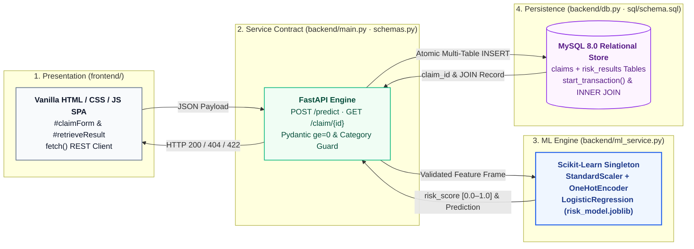
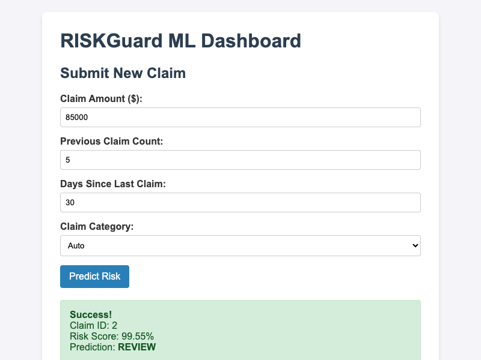
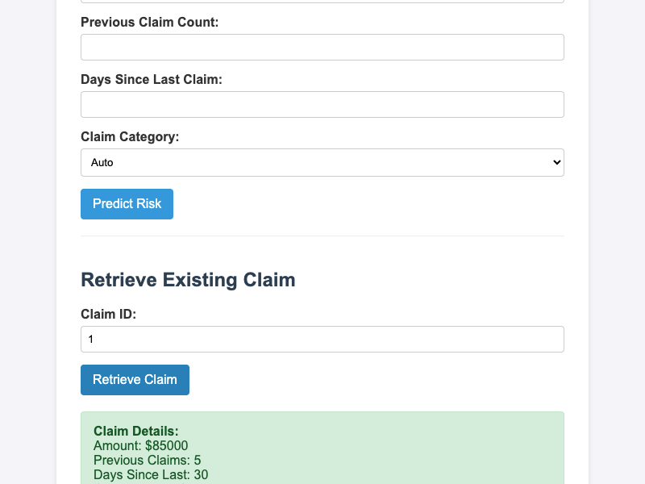
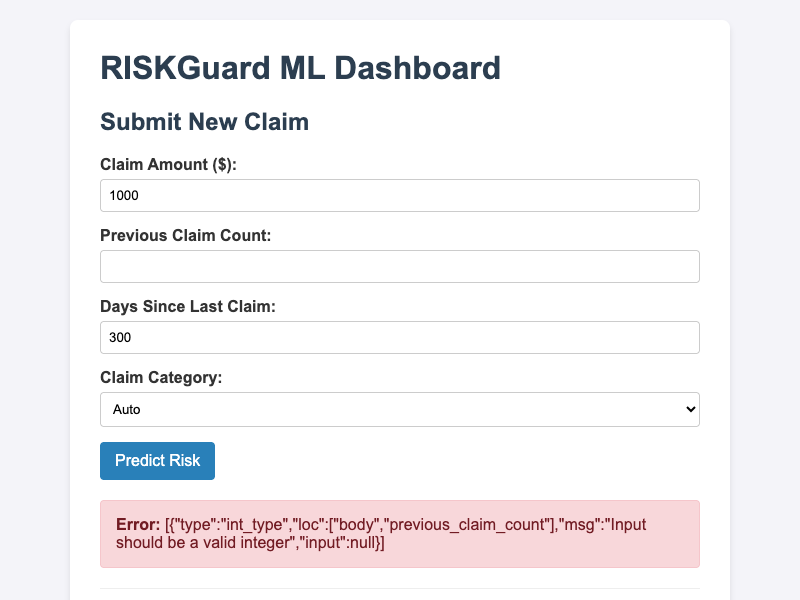
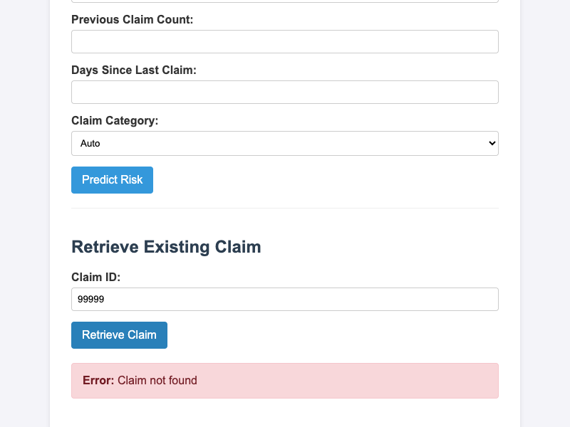

<div align="center">
  <h1>🛡️ RiskGuard</h1>
  <p><b>Full-Stack Insurance Claim Triage & Explainable ML Decision-Support System</b></p>

  <p>
    🔐 Licensed under <b>Apache License 2.0</b> &nbsp;•&nbsp;
    📌 Developed by <b>D. Sri Vighna Teja (Teja DVST)</b> | 2026
  </p>

  <div>
    <a href="https://www.python.org/"></a>
    <a href="https://fastapi.tiangolo.com/"></a>
    <a href="https://scikit-learn.org/"></a>
    <a href="https://www.mysql.com/"></a>
    <a href="https://playwright.dev/"></a>
    <a href="LICENSE"></a>
  </div>

  <p>
    <a href="#-executive-overview"><b>Overview</b></a> &nbsp;•&nbsp;
    <a href="#-system-architecture"><b>Architecture</b></a> &nbsp;•&nbsp;
    <a href="#-systems-design--engineering-rationale"><b>Design Rationale</b></a> &nbsp;•&nbsp;
    <a href="#-explainable-ml-evaluation"><b>ML Evaluation</b></a> &nbsp;•&nbsp;
    <a href="#-forensic-engineering--root-cause-analyses-rca"><b>Forensic RCA</b></a> &nbsp;•&nbsp;
    <a href="#-interface--workflow-verification"><b>Screenshots</b></a> &nbsp;•&nbsp;
    <a href="#-quickstart--reproduction"><b>Quickstart</b></a>
  </p>
</div>

---

<div align="center">

| 🎯 Held-Out Accuracy | 🔍 Review Precision | 🛡️ Review Recall | 🗄️ Persistence Model | 🧪 Verification Coverage |
| :---: | :---: | :---: | :---: | :---: |
| **87.50%**<br/>*(70 / 80 Stratified Test)* | **85.71%**<br/>*(Low False-Alarm Rate)* | **80.00%**<br/>*(High-Risk Triage Capture)* | **MySQL 8.0 ACID**<br/>*(Raw SQL Transactions)* | **16 UI Asserts + 15 Checks**<br/>*(Playwright · Selenium · SQL)* |

</div>

---

> **The Challenge:** Isolated machine learning notebooks routinely fail when integrated into transactional backend systems—unconstrained model inputs allow negative values or malformed types, disk-reloaded models add inference overhead, and schema mismatches between API contracts and relational databases trigger unhandled `HTTP 500` failures.
>
> **The Solution:** **RiskGuard** operationalizes an explainable `scikit-learn` Logistic Regression pipeline inside a decoupled **FastAPI + MySQL 8.0** service protected by dual-layer boundary validation (`Pydantic ge=0` + MySQL `CHECK` constraints), atomic `start_transaction()` persistence, and dual-framework end-to-end UI testing (**Playwright** and **Selenium**).

---

<a id="-executive-overview"></a>
## 📋 Executive Overview

Built to demonstrate cross-tier integration across ML inference, strict REST contracts, relational SQL transactions, and automated QA verification:

| 🧠 **Explainable Singleton Inference** | 🛡️ **Dual-Layer Input & Schema Contracts** |
| :--- | :--- |
| Loads a serialized <kbd>ColumnTransformer</kbd> + <kbd>LogisticRegression</kbd> pipeline (<kbd>models/risk_model.joblib</kbd>) once at startup via a module-level singleton, outputting calibrated probabilities (<kbd>round(risk_score, 4)</kbd>) and <kbd>NORMAL</kbd> / <kbd>REVIEW</kbd> routing flags. | Enforces <kbd>ge=0</kbd> numeric validation and category allowlists in <kbd>Pydantic V2</kbd> (<kbd>backend/schemas.py</kbd>) at the API edge alongside relational <kbd>CHECK</kbd> and foreign-key constraints in <kbd>sql/schema.sql</kbd>. |
| 🗄️ **ACID Multi-Table SQL Persistence** | 🧪 **Dual-Framework End-to-End QA** |
| Executes explicit <kbd>connection.start_transaction()</kbd> writes across <kbd>claims</kbd> and <kbd>risk_results</kbd> and reconstructs records via relational <kbd>INNER JOIN</kbd> queries in <kbd>backend/db.py</kbd>. | Verifies submission, validation errors, relational retrieval, and <kbd>HTTP 404</kbd> fault paths across both <kbd>Playwright</kbd> (TypeScript) and <kbd>Selenium</kbd> (Pytest) suites plus API/DB contract scripts. |

---

<a id="-system-architecture"></a>
## 🏛️ System Architecture

RiskGuard separates presentation, API validation, model inference, and transactional relational storage across four decoupled tiers:



---

<a id="-systems-design--engineering-rationale"></a>
## 💡 Systems Design & Engineering Rationale

| Requirement / Challenge | Technical Implementation | Engineering & Systems Rationale |
| :--- | :--- | :--- |
| **Model Interpretability** | **Logistic Regression** (`ColumnTransformer` + `LogisticRegression`) | Insurance and regulated risk triage require transparent feature attribution rather than opaque black-box ensembles. |
| **Input Boundary Protection** | **Dual-Layer Validation** (`Pydantic ge=0` + MySQL `CHECK`) | Prevents negative claim amounts, negative claim counts, or malformed types from reaching model inference or corrupting database tables. |
| **Atomic Multi-Table Writes** | **Explicit SQL Transactions** (`connection.start_transaction()`) | Guarantees that `claims` and `risk_results` are committed atomically—eliminating orphaned claim rows if downstream scoring or insert fails. |
| **Eliminating Model Reload Overhead** | **Module-Level Singleton** (`ml_service = MLService()`) | Deserializes `models/risk_model.joblib` once at module import rather than re-reading model weights from disk on every `POST /predict` request. |
| **Cross-Browser QA Parity** | **Dual UI Suites** (`Playwright` TS + `Selenium` Pytest) | Validates identical user journeys across two independent browser automation paradigms alongside API/DB contract checks and a Postman v2.1 collection. |

---

<a id="-explainable-ml-evaluation"></a>
## 📊 Explainable ML Evaluation

Trained via `ml/train.py` on a 400-record stratified insurance dataset (`data/riskguard_synthetic_claims.csv`, 80/20 split with `random_state=42`) using `StandardScaler` on numeric features (`claim_amount`, `previous_claim_count`, `days_since_last_claim`) and `OneHotEncoder(handle_unknown="ignore")` on `claim_category`:

* **Evaluation Script:** `docs/run_ml_evaluation.py` (captured in `docs/ml_evaluation_evidence.txt`)
* **Held-Out Confusion Matrix ($n = 80$):** $TP = 24$, $TN = 46$, $FP = 4$, $FN = 6$

| Metric | Score | Calculation & Triage Impact |
| :--- | :---: | :--- |
| **Accuracy** | **87.50%** | $70 / 80$ test claims correctly routed between `NORMAL` and `REVIEW`. |
| **Precision (`REVIEW`)** | **85.71%** | $24 / 28$ flagged claims represent true high-risk cases, limiting false-positive manual reviews. |
| **Recall (`REVIEW`)** | **80.00%** | $24 / 30$ actual high-risk claims captured for manual underwriter escalation. |

---

<a id="-forensic-engineering--root-cause-analyses-rca"></a>
## 🔍 Forensic Engineering & Root Cause Analyses (RCA)

Full commit-referenced incident logs are documented in [`docs/troubleshooting-rca.md`](docs/troubleshooting-rca.md):

### 1. The Billion-Dollar Cross-Tier Boundary Divergence &nbsp;<kbd>backend/schemas.py</kbd> &nbsp;<kbd>sql/schema.sql</kbd>

| Stage | Technical Analysis |
| :--- | :--- |
| **Symptom** | Submitting a boundary test claim with `amount = 999,999,999` passed offline ML evaluation cleanly but triggered an `HTTP 500` error in the live API. |
| **Root Cause** | Cross-tier schema mismatch: Python's Logistic Regression sigmoid handles arbitrarily large floats in memory, and Pydantic enforced `ge=0` without an upper ceiling, whereas MySQL defined `claim_amount` as `DECIMAL(10,2)` (hard ceiling `99,999,999.99`). |
| **Remediation** | Documented the storage ceiling invariant and updated evaluation harnesses to test through the full `HTTP → Pydantic → ML → MySQL` boundary (`commit 2f3cf4c`) rather than testing the raw model in isolation. |

### 2. Primary Key Column Mismatch in Relational Retrieval &nbsp;<kbd>backend/db.py</kbd>

| Stage | Technical Analysis |
| :--- | :--- |
| **Symptom** | `GET /claim/{claim_id}` failed during relational lookup after inserting valid claims (`commit cfae50d`). |
| **Root Cause** | The SQL `INNER JOIN` query referenced `c.id` instead of the actual primary key column `c.claim_id` defined in `sql/schema.sql`. |
| **Remediation** | Corrected the join predicate to `JOIN risk_results r ON c.claim_id = r.claim_id` (`commit 8bee9ed`) and verified retrieval via automated API/DB contract checks. |

---

<a id="-interface--workflow-verification"></a>
## 💻 Interface & Workflow Verification

End-to-end UI and API behavior captured across valid submission, relational retrieval, contract rejection, and missing-entity fault paths:

<table>
  <tr>
    <td width="50%" align="center" valign="top">
      <b>🟢 1. Valid Claim Ingestion & ML Scoring</b><br/><br/>
      
      <p align="left"><i><code>POST /predict</code> returns generated <code>claim_id</code>, <code>0.995</code> risk score, and <code>REVIEW</code> decision after atomic MySQL commit.</i></p>
    </td>
    <td width="50%" align="center" valign="top">
      <b>🔵 2. Relational State Retrieval (SQL JOIN)</b><br/><br/>
      
      <p align="left"><i><code>GET /claim/{id}</code> executes an <code>INNER JOIN</code> across <code>claims</code> and <code>risk_results</code> to reconstruct the full record.</i></p>
    </td>
  </tr>
  <tr>
    <td width="50%" align="center" valign="top">
      <b>🟡 3. API Contract Boundary Enforcement</b><br/><br/>
      
      <p align="left"><i>Pydantic rejects negative numeric values with structured validation feedback before model invocation.</i></p>
    </td>
    <td width="50%" align="center" valign="top">
      <b>🔴 4. Graceful 404 Fault Handling</b><br/><br/>
      
      <p align="left"><i>Non-existent claim IDs return clean <code>HTTP 404</code> responses without leaking database connections or tracebacks.</i></p>
    </td>
  </tr>
</table>

---

## 🧪 Verification & Quality Assurance Suite

| Verification Layer | Location | Coverage |
| :--- | :--- | :--- |
| **Playwright E2E Suite** | `tests/playwright/ui.spec.ts` | **8 `expect()` assertions** covering valid claim submission, validation rejection, relational retrieval, and `404` handling. |
| **Selenium UI Suite** | `tests/selenium/test_ui.py` | **8 `assert` statements** verifying identical end-to-end browser flows in headless Chrome. |
| **API & DB Contract Script** | `docs/run_api_db_validations.py` | **11 contract checks** (`6` HTTP endpoint status/payload checks + `5` MySQL row/JOIN integrity verifications). |
| **ML Behavioral & Boundary Script** | `docs/run_ml_evaluation.py` | **4 ML checks** (`3` risk-tier behavioral scenarios + `1` extreme boundary stress check) + confusion matrix report. |

---

## 📁 Repository Structure

<details>
<summary><b>View Full Directory Tree (31 Tracked Files)</b></summary>

```text
RiskGuard/
├── README.md                           # Architecture, ML evaluation, RCA logs & verification screenshots
├── LICENSE                             # Apache License 2.0
├── requirements.txt                    # Pinned Python dependencies (FastAPI 0.141.1, scikit-learn 1.9.0, Pydantic 2.13.4)
│
├── frontend/
│   ├── index.html                      # Vanilla HTML SPA claim submission & retrieval interface
│   ├── styles.css                      # Form layout & status card styling
│   └── app.js                          # Fetch-based REST client (POST /predict, GET /claim/{id})
│
├── backend/
│   ├── main.py                         # FastAPI app, CORS middleware & REST route handlers
│   ├── schemas.py                      # Pydantic V2 request/response contracts (ge=0 validation)
│   ├── ml_service.py                   # Singleton joblib model loader & probability inference wrapper
│   └── db.py                           # MySQL connector with start_transaction() inserts & INNER JOIN queries
│
├── ml/
│   ├── train.py                        # Stratified 80/20 ColumnTransformer + LogisticRegression training script
│   └── inspect_data.py                 # Dataset shape, dtype, null & class balance inspection helper
│
├── models/
│   └── risk_model.joblib               # Serialized scikit-learn classification pipeline
├── data/
│   └── riskguard_synthetic_claims.csv  # 400-row synthetic insurance claims dataset
├── sql/
│   └── schema.sql                      # MySQL 8.0 DDL for claims & risk_results with CHECK & FK constraints
│
├── tests/
│   ├── playwright/                     # TypeScript Playwright E2E suite (ui.spec.ts, playwright.config.ts)
│   └── selenium/                       # Python Pytest Selenium suite (conftest.py, test_ui.py)
│
└── docs/
    ├── troubleshooting-rca.md          # Commit-referenced Root Cause Analysis logs
    ├── run_ml_evaluation.py            # Offline confusion matrix & behavioral scenario runner
    ├── run_api_db_validations.py       # Live API + MySQL contract validation script
    ├── manual-test-cases.md            # Structured manual QA test matrix
    ├── sql_interview_drills.sql        # Relational SQL query drills on the riskguard schema
    ├── riskguard_postman_collection.json # Postman v2.1 API collection
    └── screenshots/                    # 4 UI verification PNGs (800x600)
```

</details>

---

<a id="-quickstart--reproduction"></a>
## 🚀 Quickstart & Reproduction

```bash
# 1. Clone & set up Python virtual environment
git clone https://github.com/SRIVIGHNATEJA/RiskGuard.git
cd RiskGuard
python3 -m venv .venv && source .venv/bin/activate
pip install -r requirements.txt

# 2. Initialize MySQL 8.0 schema & configure local .env database credentials
mysql -u root -p < sql/schema.sql
# Create a .env file in the repo root with your MySQL host, user, password, and database (`riskguard`)

# 3. Start FastAPI backend (:8000) and static frontend (:8080)
uvicorn backend.main:app --host 127.0.0.1 --port 8000 &
cd frontend && python3 -m http.server 8080 --bind 127.0.0.1

# 4. Run UI, API/DB contract & ML evaluation scripts
pytest tests/selenium/ -v
npx playwright test --config=tests/playwright/playwright.config.ts
python3 docs/run_api_db_validations.py
python3 docs/run_ml_evaluation.py
```

---

## 📜 License

This repository is licensed under the **Apache License 2.0** — see the [LICENSE](LICENSE) file for complete terms.

---

## 👤 Author & Contributions

**D. Sri Vighna Teja (`Teja DVST`)** — Hyderabad, India

* 📄 **Technical Focus:** Deterministic AI guardrails, financial & risk decision-support systems, auditable pipelines, and edge ML engineering.
* 🌐 **Portfolio:** [srivighnateja.vercel.app](https://srivighnateja.vercel.app)
* 💻 **GitHub:** [github.com/SRIVIGHNATEJA](https://github.com/SRIVIGHNATEJA)
* 💼 **LinkedIn:** [linkedin.com/in/srivighnateja](https://www.linkedin.com/in/srivighnateja)
* 🆔 **ORCID:** [0009-0009-8611-2292](https://orcid.org/0009-0009-8611-2292)
* 🎓 **Google Scholar:** [scholar.google.com/citations?user=C6qgWiMAAAAJ](https://scholar.google.com/citations?user=C6qgWiMAAAAJ&hl=en)

---

<div align="center">
  <i>Built with focus on cross-tier API/database boundary integrity, explainable ML triage, and automated QA verification.</i>
</div>
